# mmd-viz

Turn standard Mermaid diagrams into sleek, **zero-JS animated SVGs**—ready for GitHub READMEs, static docs, and light/dark themes.

Powered by [`pele`](https://github.com/obsidianmd/pele) (synchronous, zero-DOM Mermaid layout engine).

**[Try the Live Playground →](https://phil65.github.io/mmd-viz/)** · [Supported Diagrams Matrix](./DIAGRAMS.md)



### More Examples

**Subgraphs, decision diamonds, edge labels & feedback loops:**


**Light theme (top-down flowchart):**


**Sequence diagrams (chronological message relay):**


**State machines (`stateDiagram-v2`):**


**Git graphs (`gitGraph`):**



**Tokyo Night theme + thick (`==>`) & dotted (`-.->`) edge weights:**



**Architecture (`architecture-beta`):**



**Sankey (`sankey-beta` centerline particle streams):**


**Gantt (`gantt` with sweeping playhead):**


**Timeline (`timeline` axis & pulsing milestones):**


**Mind maps from plain Markdown (headings & lists, branches grow once):**



## Features

- **Zero JS in output** — pure CSS `@keyframes` + SMIL `<animateMotion>`, so animations work directly inside GitHub `` tags.
- **No browser / Puppeteer required** — synchronous rendering in milliseconds.
- **8 built-in themes + `--theme auto`** — `dark`, `light`, `auto` (OS `prefers-color-scheme`), `tokyo-night`, `catppuccin`, `nord`, `github-dark`, `github-light`.
- **Every diagram type animated, in a way that fits it** — packets for flow (`flowchart`, `architecture`, `c4`, `block`, `swimlane`, `usecase`, `sankey` with particles in proportion to each ribbon), a step-by-step relay for things that happen in order (`sequenceDiagram`, `stateDiagram-v2`, `agentflow`, `eventmodeling`, `gitGraph` history), time (`gantt` playhead, `timeline` pulse, `journey` walk), motions of their own (`railroad` token, `ishikawa` causes flowing into the effect, `mindmap` growing) and a one-time build-up for structure and data (`class`, `er`, `pie`, `xychart`, `radar`, `kanban`, `treemap`, …). See [DIAGRAMS.md](./DIAGRAMS.md) for all 33.
- **Mind maps from Markdown** — headings, nested lists and paragraphs become branches (the outline format markmap reads, including `<!-- markmap: fold -->`), laid out by pele's mindmap engine.
- **Batch CLI mode** — pass a directory to recursively render all `*.mmd` and `*.mindmap.md` files to `*.svg`.
- **Accessible & portable** — respects `prefers-reduced-motion`, uses negative `begin` offsets so no particles park at `(0, 0)` on frame 0, and supports `--transparent`, `--speed`, and `--static`.

## CLI Usage

```bash
# Single file
npx mmd-viz diagram.mmd -o diagram.svg

# Batch-render a directory of *.mmd files
npx mmd-viz docs/diagrams -o docs/assets --theme auto

# Extract & render all ```mermaid (and ```markmap) blocks from a Markdown file
npx mmd-viz extract README.md -o docs/assets --theme auto

# A Markdown outline as a mind map (*.mindmap.md, or any Markdown with --mindmap)
npx mmd-viz plan.mindmap.md -o plan.svg
cat notes.md | npx mmd-viz --mindmap --expand-level 2 > notes.svg

# From stdin with theme, speed, title, and footer
cat diagram.mmd | npx mmd-viz \
  --title "Architecture" \
  --footer "define once in YAML" \
  --theme tokyo-night \
  --speed 1.2 \
  -o diagram.svg

# Transparent background or static (no animations)
npx mmd-viz diagram.mmd --transparent --static -o diagram.svg
```

## TypeScript / JavaScript API

```bash
npm install mmd-viz
```

```ts
import { renderAnimatedSvg } from "mmd-viz";

const svg = renderAnimatedSvg(
  `flowchart LR
    native["Native Agent<br/>PydanticAI · Tools"]:::cyan --> hub(["AgentPool<br/>MessageNode"]):::hub
    acp["ACP Agent<br/>Goose · Codex"]:::indigo --> hub
    hub --> server["ACP Server<br/>Zed · VS Code"]:::emerald
  `,
  {
    title: "AgentPool",
    footer: "define once in YAML",
    theme: "dark", // "dark" | "light"
    animate: true,
  }
);
```

### Mind maps

```ts
import { markdownToMindmap, parseOutline, renderMindmapSvg } from "mmd-viz";
import { render } from "pele";

const markdown = `# Launch
## Build
- **Core** features
- Beta <!-- markmap: fold -->
  - Invites
## Ship
- Release notes`;

// Themed SVG, like renderAnimatedSvg
const svg = renderMindmapSvg(markdown, { theme: "auto", expandLevel: 2 });

// Or pele's model, to render (and re-render) yourself: every node's outline id
// ("0", "0.1", "0.1.0", ...) is its `data-id` in the SVG, so a click can fold it.
const model = markdownToMindmap(markdown, {
  folds: new Map([["0.0", true]]), // true folds, false unfolds
  foldedLabel: (text, hidden) => `${text} +${hidden}`,
});
const { svg: plain } = render(model);

// Or just the tree
const { root, title } = parseOutline(markdown);
```

Headings nest by level, list items by indentation, paragraphs become leaves;
code blocks, tables and rules are left out. Links and images become their text,
task items get ☐ / ☑. A single top-level heading or item is the root, otherwise
the frontmatter `title` (or `rootLabel`) names one.

## Mermaid Styling Conventions

Everything is standard Mermaid syntax:

| Convention | Effect |
| :--- | :--- |
| `:::cyan`, `:::indigo`, `:::amber`, `:::emerald`, `:::pink`, `:::rose`, `:::violet` | Adds a colored card accent bar and color-matches connected wires, arrowheads, and animated packets. |
| `:::hub` | Highlights a focal node with a gradient fill, monospace subtitle, and pulsing outer ring. |
| `"Title<br/>Subtitle"` | Renders line 1 as bold title and line 2 as muted subtitle. |

## License

MIT
