# mmd-viz

Turn standard Mermaid diagrams into sleek, **zero-JS animated SVGs**—ready for GitHub READMEs, static docs, and light/dark themes.

Powered by [`pele`](https://github.com/obsidianmd/pele) (synchronous, zero-DOM Mermaid layout engine).


### More Examples

**Subgraphs, decision diamonds, edge labels & feedback loops:**



**Light theme (top-down flowchart):**


**Sequence diagrams (and other Pele diagram types):**


## Features

- **Zero JS in output** — pure CSS `@keyframes` + SMIL `<animateMotion>`, so animations work directly inside GitHub `` tags.
- **No browser / Puppeteer required** — synchronous rendering in milliseconds.
- **Standard Mermaid conventions** — uses normal `:::class` accents and `<br/>` titles/subtitles (stays 100% valid in standard Mermaid viewers).
- **Accessible & portable** — respects `prefers-reduced-motion`, uses negative `begin` offsets so no particles park at `(0, 0)` on frame 0, and supports `dark` / `light` themes.

## CLI Usage

```bash
# From a file
npx mmd-viz diagram.mmd -o diagram.svg

# From stdin with title, footer, and theme
cat diagram.mmd | npx mmd-viz \
  --title "Architecture" \
  --footer "define once in YAML" \
  --theme dark \
  -o diagram.svg

# Styled static SVG (no animations)
npx mmd-viz diagram.mmd --static -o diagram.svg
```

## TypeScript / JavaScript API

```bash
npm install mmd-viz
```

```ts
import { renderAnimatedSvg } from "mmd-viz";

const svg = renderAnimatedSvg(
  `flowchart LR
    native["Native Agent<br/>PydanticAI · Tools"]:::cyan --> hub(["AgentPool<br/>MessageNode"]):::hub
    acp["ACP Agent<br/>Goose · Codex"]:::indigo --> hub
    hub --> server["ACP Server<br/>Zed · VS Code"]:::emerald
  `,
  {
    title: "AgentPool",
    footer: "define once in YAML",
    theme: "dark", // "dark" | "light"
    animate: true,
  }
);
```

## Mermaid Styling Conventions

Everything is standard Mermaid syntax:

| Convention | Effect |
| :--- | :--- |
| `:::cyan`, `:::indigo`, `:::amber`, `:::emerald`, `:::pink`, `:::rose`, `:::violet` | Adds a colored card accent bar and color-matches connected wires, arrowheads, and animated packets. |
| `:::hub` | Highlights a focal node with a gradient fill, monospace subtitle, and pulsing outer ring. |
| `"Title<br/>Subtitle"` | Renders line 1 as bold title and line 2 as muted subtitle. |

## License

MIT
