# mmd-viz

Turn standard Mermaid diagrams into sleek, **zero-JS animated SVGs**—ready for GitHub READMEs, static docs, and light/dark themes.

Powered by [`pele`](https://github.com/obsidianmd/pele) (synchronous, zero-DOM Mermaid layout engine).

**[Try the Live Playground →](https://phil65.github.io/mmd-viz/)** · [Supported Diagrams Matrix](./DIAGRAMS.md)


### More Examples

**Subgraphs, decision diamonds, edge labels & feedback loops:**


**Light theme (top-down flowchart):**


**Sequence diagrams (chronological message relay):**


**State machines (`stateDiagram-v2`, one transition at a time):**


**Git graphs (`gitGraph`, history replaying commit by commit):**


**Tokyo Night theme + thick (`==>`) & dotted (`-.->`) edge weights:**


**Architecture (`architecture-beta`):**


**Sankey (`sankey-beta`, particles in proportion to each flow):**


**Gantt (`gantt` with sweeping playhead):**


**Timeline (`timeline` axis & pulsing milestones):**


**Mind maps from plain Markdown (headings & lists, branches grow once):**


**Charts and structure build up once (`pie`, `classDiagram`, …):**





**Motions of their own (`journey` walking the experience, `ishikawa` causes flowing into the effect):**





All images are generated from [assets/src](./assets/src) (`npm run assets`).

## Features

- **Zero JS in output** — pure CSS `@keyframes` + SMIL `<animateMotion>`, so animations work directly inside GitHub `` tags.
- **No browser / Puppeteer required** — synchronous rendering in milliseconds.
- **8 built-in themes + `--theme auto`** — `dark`, `light`, `auto` (OS `prefers-color-scheme`), `tokyo-night`, `catppuccin`, `nord`, `github-dark`, `github-light`.
- **Every diagram type animated, in a way that fits it** — packets for flow (`flowchart`, `architecture`, `c4`, `block`, `swimlane`, `usecase`, `sankey` with particles in proportion to each ribbon), a step-by-step relay for things that happen in order (`sequenceDiagram`, `stateDiagram-v2`, `agentflow`, `eventmodeling`, `gitGraph` history), time (`gantt` playhead, `timeline` pulse, `journey` walk), motions of their own (`railroad` token, `ishikawa` causes flowing into the effect, `mindmap` growing) and a one-time build-up for structure and data (`class`, `er`, `pie`, `xychart`, `radar`, `kanban`, `treemap`, …). See [DIAGRAMS.md](./DIAGRAMS.md) for all 33.
- **Mind maps from Markdown** — headings, nested lists and paragraphs become branches (the outline format markmap reads, including `<!-- markmap: fold -->`), laid out by pele's mindmap engine.
- **Batch CLI mode** — pass a directory to recursively render all `*.mmd` and `*.mindmap.md` files to `*.svg`.
- **Accessible & portable** — respects `prefers-reduced-motion`, uses negative `begin` offsets so no particles park at `(0, 0)` on frame 0, and supports `--transparent`, `--speed`, and `--static`.

## CLI Usage

```bash
# Single file
npx mmd-viz diagram.mmd -o diagram.svg

# Batch-render a directory of *.mmd files
npx mmd-viz docs/diagrams -o docs/assets --theme auto

# Extract & render all ```mermaid (and ```markmap) blocks from a Markdown file
npx mmd-viz extract README.md -o docs/assets --theme auto

# A Markdown outline as a mind map (*.mindmap.md, or any Markdown with --mindmap)
npx mmd-viz plan.mindmap.md -o plan.svg
cat notes.md | npx mmd-viz --mindmap --expand-level 2 > notes.svg

# From stdin with theme, speed, title, and footer
cat diagram.mmd | npx mmd-viz \
  --title "Architecture" \
  --footer "define once in YAML" \
  --theme tokyo-night \
  --speed 1.2 \
  -o diagram.svg

# Transparent background or static (no animations)
npx mmd-viz diagram.mmd --transparent --static -o diagram.svg
```

## TypeScript / JavaScript API

```bash
npm install mmd-viz
```

```ts
import { renderAnimatedSvg } from "mmd-viz";

const svg = renderAnimatedSvg(
  `flowchart LR
    native["Native Agent<br/>PydanticAI · Tools"]:::cyan --> hub(["AgentPool<br/>MessageNode"]):::hub
    acp["ACP Agent<br/>Goose · Codex"]:::indigo --> hub
    hub --> server["ACP Server<br/>Zed · VS Code"]:::emerald
  `,
  {
    title: "AgentPool",
    footer: "define once in YAML",
    theme: "dark", // "dark" | "light"
    animate: true,
  }
);
```

### Markdown pipelines (remark / rehype)

Static sites and docs (Astro, Docusaurus, Next.js MDX, plain unified) can turn ```` ```mermaid ````
and ```` ```markmap ```` blocks into animated diagrams at build time, with no headless browser:

```ts
import { rehypeMmdViz } from "mmd-viz/markdown";

unified()
  .use(remarkParse)
  .use(remarkRehype)
  .use(rehypeMmdViz, { theme: "auto" }) // before syntax highlighters
  .use(rehypeStringify);
```

`remarkMmdViz` does the same for pipelines that stay in Markdown (it writes `html` nodes).

- Each diagram becomes an `` with the SVG as a data URL (its CSS stays its own, the animation
  still plays); `as: "svg"` inlines the SVG instead (needs `allowDangerousHtml` / `rehype-raw`).
- All `renderAnimatedSvg` options apply; a block can override them in its fence:
  ```` ```mermaid theme=light title="Login flow" static ```` (also `footer=`, `speed=`, `alt=`,
  `transparent`).
- `mermaid` / `mindmap` set which fence languages are drawn (`["mermaid"]`, `["markmap"]`);
  `onError: "keep" | "throw" | fn` decides what happens to a block that doesn't parse (kept as code
  by default).

### Animating pele's SVGs inside an app

`renderAnimatedSvg` frames a diagram for READMEs and docs (its own canvas, theme and fonts). An
app that already draws with pele, in its own colors, can add just the motion:

```ts
import { animateSvg, loops } from "mmd-viz/animate";
import { renderAsync } from "pele/lazy";

const { svg, type } = await renderAsync(source);
const animated = animateSvg(svg, type, { idPrefix: "d1" }); // unique per SVG on the page
// loops(type): false for types that build up once (pie, class, kanban, …), true where
// packets keep moving, so only those need pausing while out of view
```

The drawing stays as pele made it, colors follow the page's `--pele-*` variables (packets use
pele's accent `--_c` and `--pele-series-N`), and `mmd-viz/animate` imports nothing from pele, so
diagram types still load on demand.

### Interaction in a page (opt-in)

The SVGs stay zero-JS; in a page, `mmd-viz/interactive` adds interaction to any of them (framed,
animated with `animateSvg`, or plain pele output):

```ts
import { interactive } from "mmd-viz/interactive";

const controls = interactive(container.querySelector("svg")!, {
  onChange: ({ step, steps, focus }) => render(step, steps),
});
controls.next(); // sequence and state diagrams: step through messages / transitions
controls.reset();
```

- **Hover** a node: it, its edges and its neighbors stay, the rest fades (flowchart, C4,
  architecture, state, class, ER, …). **Sankey**: a node shows every flow through it, a ribbon its
  two ends. **gitGraph**: a branch, commit or line shows that branch.
- **Stepping** (`steps > 0` for sequence, state, agentflow and event-model diagrams): `next()`,
  `prev()`, `setStep(n)`, `reset()`; past steps stay dimmed, the current one is bright, and where
  a step leads somewhere (a state, the agent work is handed to) that node lights up too. Packets
  hide while stepping.
- Nothing is drawn again: it sets classes and adds a small stylesheet; `destroy()` removes both.
  The [playground](https://phil65.github.io/mmd-viz/) uses it (arrow keys step).

### Folding (tree views, class diagrams, flowchart subgraphs)

`mmd-viz/fold` folds a `treeView-beta` folder (its entries), a `classDiagram` class (its members)
or a flowchart `subgraph` (into one node; edges into it end there). Draw the result again
(`folded.model` for flowcharts, else `folded.source`) and map clicks back with `keyAt`:

```ts
import { canFold, fold } from "mmd-viz/fold";

const folds = new Set<string>();
const folded = fold(source, type, folds); // { source, foldable, keyAt }
draw(folded.source);
// on a click on the n-th g.pele-node with data-id `id`:
const key = folded.keyAt(n, id); // "L4" (tree entry on line 4), "Animal" (class), "backend"
// (subgraph: its g.pele-cluster frame or the node it folded into); null if it can't fold
```

Flowcharts fold on pele's parsed model, so register the type with `pele/core` first (`import
"pele"` or `pele/lazy`'s `load("flowchart")`).

A folded folder reads `src (+3)`, a folded class keeps its name and annotations with
`⋯ 3 members`, a folded subgraph `Backend (+3)`. Mind maps fold through their outline (`markdownToMindmap`'s `folds`). The
playground folds on click.

### Mind maps

```ts
import { markdownToMindmap, parseOutline, renderMindmapSvg } from "mmd-viz";
import { render } from "pele";

const markdown = `# Launch
## Build
- **Core** features
- Beta <!-- markmap: fold -->
  - Invites
## Ship
- Release notes`;

// Themed SVG, like renderAnimatedSvg
const svg = renderMindmapSvg(markdown, { theme: "auto", expandLevel: 2 });

// Or pele's model, to render (and re-render) yourself: every node's outline id
// ("0", "0.1", "0.1.0", ...) is its `data-id` in the SVG, so a click can fold it.
const model = markdownToMindmap(markdown, {
  folds: new Map([["0.0", true]]), // true folds, false unfolds
  foldedLabel: (text, hidden) => `${text} +${hidden}`,
});
const { svg: plain } = render(model);

// Or just the tree
const { root, title } = parseOutline(markdown);
```

Headings nest by level, list items by indentation, paragraphs become leaves;
code blocks, tables and rules are left out. Links and images become their text,
task items get ☐ / ☑. A single top-level heading or item is the root, otherwise
the frontmatter `title` (or `rootLabel`) names one.

## Mermaid Styling Conventions

Everything is standard Mermaid syntax:

| Convention | Effect |
| :--- | :--- |
| `:::cyan`, `:::indigo`, `:::amber`, `:::emerald`, `:::pink`, `:::rose`, `:::violet` | Adds a colored card accent bar and color-matches connected wires, arrowheads, and animated packets. |
| `:::hub` | Highlights a focal node with a gradient fill, monospace subtitle, and pulsing outer ring. |
| `"Title<br/>Subtitle"` | Renders line 1 as bold title and line 2 as muted subtitle. |

## License

MIT
